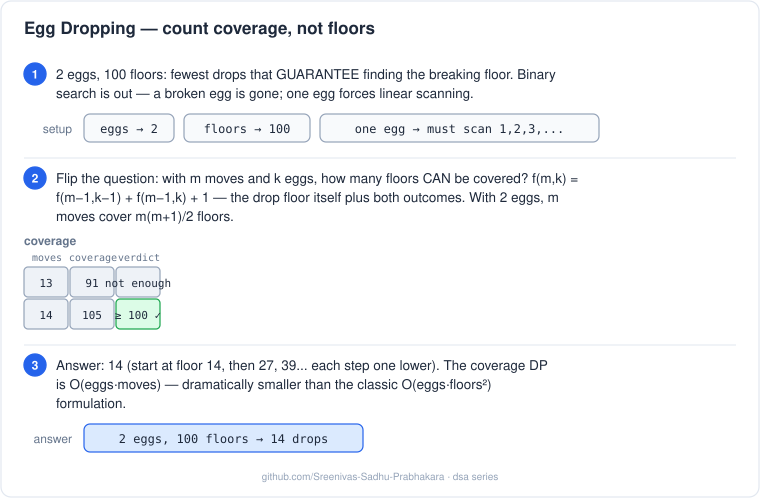

# Egg Dropping

> Striver SDE Sheet 181 · Day 26 DP II — invert the question: not "trials for f floors" but "floors covered by m trials"; the answer explodes binomially, so m stays tiny. Go, stdlib only, tested.

## Problem

With e eggs and f floors, how many trials *guarantee* identifying the highest safe floor, against worst-case luck? (2 eggs, 100 floors → the famous 14.)

## Approach

The direct DP ("min trials for e eggs, f floors") is O(e·f²) and the textbook slog. The inversion is the insight: let `cover(m, e)` be the floors decidable with m moves and e eggs. One drop splits the world — breaks: m−1 moves, e−1 eggs below; survives: m−1 moves, e eggs above — so `cover(m,e) = cover(m−1,e−1) + cover(m−1,e) + 1`. Grow m until coverage reaches f. Since cover(m, e) = ΣC(m, i) grows binomially, m hits the answer in ~O(e·log f) steps on one rolling row (updated e-descending so the previous move's values are still in place). Same trick solves "minimum moves" variants across the DP family.

**Complexity:** O(e · answer) time, O(e) space.

## Visual walkthrough

Read the picture top to bottom — each numbered frame is one moment of the algorithm
running on this repo's test example.

## Run

    go test ./...   # verify
    go run .        # demo

---

One of 191 repos solving Striver's SDE Sheet in Go — stdlib only, one problem per repo, every solution tested. Browse the set: [`dsa-*` repos](https://github.com/Sreenivas-Sadhu-Prabhakara?tab=repositories&q=dsa-&type=source).
